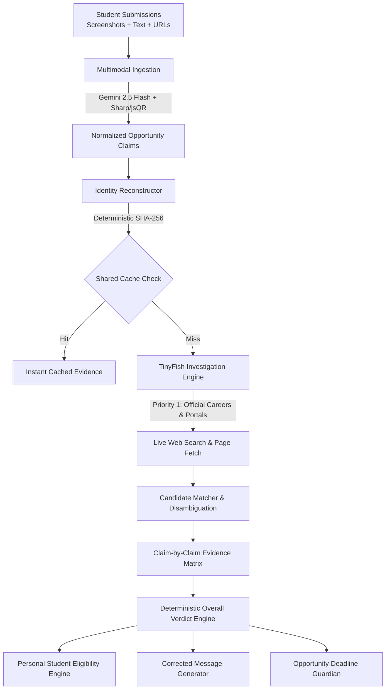

# 🛡️ Phishy? — Verify Before You Apply

> **An AI-powered Opportunity Intelligence Platform that protects students and freshers from fraudulent internships, manipulated recruitment deadlines, and scholarship phishing scams.**

[](https://github.com/)
[](https://nodejs.org/)
[](https://vitejs.dev/)
[](https://aistudio.google.com/)
[](https://tinyfish.ai/)

---

## 📌 1. The Problem & Product Vision

Every single day, college students and job seekers receive forwarded messages across WhatsApp and Telegram, emails, and poster banners announcing student opportunities:

- **Internships & Fresher Jobs**
- **Scholarships & Government Fellowships**
- **Hackathons & Competitions**

### Why Standard Link Scanners Fail:
Existing safety tools and antivirus checkers only verify whether a domain exists or whether an IP is flagged on malware blocklists. Generic chatbots simply guess whether text looks informal.

**Phishy? introduces a completely new paradigm:**
> **We do not merely check whether a company exists. We reconstruct the exact opportunity, verify official organization identity, and cross-reference each claim individually against evidence extracted from live official sources.**

---

## 🚀 2. Key Differentiators

| Feature | Generic Spam / Link Checker | Phishy? Intelligence Platform |
| :--- | :--- | :--- |
| **Input Support** | Single URL only | **Multimodal**: Combines screenshots, forwarded text, and URLs into a single investigation |
| **Investigation** | Domain WHOIS / blocklist lookup | **Live Official Source Inspection**: Queries verified career portals, government domains, and company sites via TinyFish |
| **Claim Breakdown** | Vague "92% Safe" heuristic score | **Claim-by-Claim Verification Matrix**: Individually assesses Role, Deadline, Fees, Batch, and URLs with source evidence snippets |
| **Personal Intelligence** | None | **Student Profile Compatibility**: Evaluates whether *your* degree, branch, and graduation year qualify |
| **Misinformation Defense** | Warning banner | **Corrected Message Generator**: Generates 1-click shareable verified notice to combat WhatsApp/Telegram forwards |
| **Monitoring** | Static one-time check | **Deadline Guardian**: Tracks official portals for deadline extensions, closures, and status changes |

---

## 🏗️ 3. Architecture & Tech Stack



### Technology Highlights:
- **Frontend**: React 18, Vite, Tailwind CSS, Lucide React, Axios, React Router 6.
- **Backend**: Node.js, Express.js (ES Modules), Helmet security headers, Express Rate Limiter, Multer in-memory buffers.
- **Multimodal AI**: Official `@google/genai` SDK using Gemini Vision for image understanding and structured JSON extraction.
- **Web Investigation**: Official `@tiny-fish/sdk` & TinyFish REST APIs (`api.search.tinyfish.ai`, `api.fetch.tinyfish.ai`) for live browsing of verified portals.
- **Database & Persistence**: MongoDB Atlas with Mongoose schemas + In-Memory Persistence Fallback (zero configuration required for instant offline testing).
- **Security & SSRF Defense**: Enforced URL scheme validation, DNS resolution, private subnet blocking (10.x, 172.16.x, 192.168.x, 127.x, 169.254.169.254).

---

## 📂 4. Project Structure

```
phishy/
├── client/                     # Vite + React Frontend
│   ├── src/
│   │   ├── components/         # Reusable UI & Investigation widgets
│   │   │   ├── layout/         # Navbar, Footer, MainLayout
│   │   │   ├── ui/             # VerdictBadge, Button, Card, Alert, LoadingSpinner
│   │   │   ├── investigation/  # ImageDropzone, ActivityPanel
│   │   │   └── results/        # ClaimCard, CoverageMeter, CorrectedMessage, EligibilityPanel
│   │   ├── context/            # StudentProfileContext, InvestigationContext
│   │   ├── pages/              # 7 Complete Responsive Application Pages
│   │   │   ├── HomePage.jsx
│   │   │   ├── ResultsPage.jsx
│   │   │   ├── HistoryPage.jsx
│   │   │   ├── ProfilePage.jsx
│   │   │   ├── GuardianPage.jsx
│   │   │   ├── AboutPage.jsx
│   │   │   └── NotificationsPage.jsx
│   │   ├── services/api.js     # Axios API layer
│   │   ├── utils/cn.js         # Tailwind merge utility
│   │   ├── App.jsx             # Router and Lazy loading configuration
│   │   └── main.jsx
│   └── vite.config.js
│
├── server/                     # Node.js + Express Backend
│   ├── src/
│   │   ├── config/             # Environment & MongoDB configuration
│   │   ├── controllers/        # Investigation, Opportunity, Eligibility, Monitoring
│   │   ├── middleware/         # SSRF protection, Multer upload, Rate limiting, Error handler
│   │   ├── models/             # Mongoose schemas + in-memory fallback layer
│   │   ├── routes/             # Express API routes
│   │   ├── services/
│   │   │   ├── gemini/         # Gemini Client, Multimodal Extractor, QR Scanner
│   │   │   ├── tinyfish/       # TinyFish Client, Official Search & Page Fetch services
│   │   │   ├── identity/       # Identity Reconstructor & Candidate Matcher
│   │   │   ├── comparison/     # Claim Comparator & Contact Verifier
│   │   │   ├── verdict/        # Deterministic Verdict Engine & Coverage Calculator
│   │   │   ├── eligibility/    # Student Eligibility Engine
│   │   │   ├── correction/     # Corrected WhatsApp Message Generator
│   │   │   ├── cache/          # Shared SHA-256 Verification Cache
│   │   │   ├── monitoring/     # Opportunity Deadline Guardian
│   │   │   └── orchestrator/   # Real-time SSE Investigation Pipeline
│   │   ├── tests/              # 8 comprehensive test suites (31 passing tests)
│   │   ├── app.js
│   │   └── server.js
│   └── package.json
│
├── .env.example
├── package.json                # Root orchestration scripts
└── README.md
```

---

## ⚡ 5. Quick Start & Setup Instructions

### Prerequisites:
- **Node.js**: v20 or higher (`node -v`)
- **npm**: v10 or higher (`npm -v`)

### Step 1: Clone or Navigate to Directory
```bash
cd phishy
```

### Step 2: Install Dependencies
```bash
# Install server dependencies
npm --prefix server install

# Install client dependencies
npm --prefix client install
```

### Step 3: Configure Environment
Copy `.env.example` to `server/.env`:
```bash
cp .env.example server/.env
```

Edit `server/.env` to include your API keys when ready:
```env
PORT=5000
NODE_ENV=development
CLIENT_URL=http://localhost:5173

# Optional: MongoDB Atlas (falls back to memory store if omitted)
MONGODB_URI=

# Optional: Google Gemini API (falls back to heuristic NLP parser if omitted)
# Obtain free from: https://aistudio.google.com/app/apikey
GEMINI_API_KEY=your_gemini_api_key_here
GEMINI_MODEL=gemini-3.8-flash

# Optional: TinyFish API (free allowance available)
# Obtain from: https://agent.tinyfish.ai/api-keys
TINYFISH_API_KEY=your_tinyfish_api_key_here
```

> **Note on Zero-Configuration:** You can run and test the complete application immediately even without external API keys. The application includes heuristic parsing, deterministic matching, and in-memory persistence. When external credentials are added, live Gemini and TinyFish engines take over automatically.

### Step 4: Run the Application

#### Option A: Unified Full-Stack Server (Production & Demo Mode)
Build the frontend and start the Express server (which directly serves both API and UI on port 5000):
```bash
npm --prefix client run build
npm --prefix server start
```
Open **`http://localhost:5000`** in your browser.

#### Option B: Concurrent Development Mode (Vite HMR)
Run backend and frontend concurrently in two terminals:
```bash
# Terminal 1: Backend
npm run server

# Terminal 2: Frontend
npm run client
```
Open **`http://localhost:5173`** for live Vite hot-module replacement.

---

## 🧪 6. Automated Test Suite (31 Tests Passing)

The project includes unit, integration, and security tests covering all 19 prompt requirements:

```bash
npm --prefix server test
```

### Verified Test Matrix:
| Test Suite | File | Tests | Coverage |
| :--- | :--- | :--- | :--- |
| **Claim Verification** | `claimComparison.test.js` | 5 | Valid matches, manipulated deadlines, fake fees, phishing links, inaccessible sites |
| **Identity Disambiguation**| `identity.test.js` | 3 | Distinguishing roles/batches at same company, candidate scoring, unknown orgs |
| **Multimodal Extraction** | `extraction.test.js` | 4 | Text parsing, URL handling, combined inputs, QR code buffer handling |
| **Student Eligibility** | `eligibility.test.js` | 4 | Batch matching, degree/branch qualification, missing profile handling |
| **SSRF Security** | `ssrf.test.js` | 4 | Localhost, private IPs (10.x, 192.168.x), AWS metadata (169.254.169.254), non-HTTP protocols |
| **Shared Cache** | `cache.test.js` | 3 | SHA-256 fingerprinting, check count increments, cache hit reuse |
| **Deadline Guardian** | `monitoring.test.js` | 3 | Snapshot comparison, change detection, in-app notifications |
| **API Endpoints** | `api.test.js` | 5 | Health check, extraction, eligibility, investigations, notifications |

---

## 🛡️ 7. Security Design & Threat Mitigation

1. **SSRF & Private Network Isolation:**
   All candidate and user-submitted URLs pass through strict DNS and subnet checks. Loops (`127.0.0.1`), LAN subnets (`192.168.0.0/16`, `10.0.0.0/8`, `172.16.0.0/12`), and Cloud Metadata endpoints (`169.254.169.254`) are blocked before network dispatch.
2. **Untrusted Content Sanitization:**
   Web page text fetched during investigation is treated strictly as untrusted data, never as execution instructions, mitigating prompt injection.
3. **No Permanent Screenshot Storage:**
   Uploaded screenshots are analyzed in-memory (RAM buffer) and never permanently stored on disk without disclosure.
4. **Rate Limiting:**
   Global API rate limiting (100 req/15 min) and investigation limiting (20 req/min) prevent abuse.
5. **Shared Cache Privacy:**
   Private user metadata, student names, and raw screenshot images are stripped from the shared verification cache. Only sanitized public opportunity findings are cached.

---

## 🏆 8. Hackathon Demonstration Guide

To demonstrate Phishy? to hackathon judges:

1. **Test Genuine Program:**
   - Paste: *"Google India Software Engineering Intern 2027. Apply at https://careers.google.com/jobs/results"*
   - Watch the **Live Activity Panel** stream real-time steps (Gemini multimodal extraction, identity reconstruction, TinyFish search and fetch).
   - Observe the **`VERIFIED`** badge with evidence snippets from Google's official career portal.
2. **Test Scam with Registration Fee:**
   - Paste: *"Amazon Fresher Hiring 2027. Registration fee: ₹499. Apply before Nov 15 on bit.ly/amzn-apply"*
   - Observe the **`SUSPICIOUS`** verdict highlighting unauthorized fee demands and unofficial bit.ly destination.
   - Click **"Copy Message"** on the **Corrected Message Generator** to show how students can forward the debunked warning to their WhatsApp groups.
3. **Personal Eligibility Check:**
   - Go to **My Profile** and set graduation year to `2028`.
   - Run an opportunity for `2027 graduates`.
   - Notice the **`NOT ELIGIBLE`** badge with exact batch mismatch explanation.
4. **Opportunity Deadline Guardian:**
   - Save any opportunity to your Watchlist.
   - Open **Deadline Guardian** to view automated 6-hour polling, previous snapshots, and change alerts.

---

*Built with ❤️ for college students, freshers, and job seekers everywhere.*


## Important verification behaviour

- An unfamiliar third-party application platform is treated as **unverified** unless an official page links to it. Known general shorteners and public form hosts are flagged as high risk and should be verified through an official organization page.
- A **suspicious** verdict is reserved for high-confidence contradictions supported by official evidence.
- Personal eligibility is displayed only after the opportunity itself receives a VERIFIED verdict. Eligibility is an informational assessment, not a legal determination or guarantee of selection.
- Screenshot extraction remains available when Gemini is configured; if an image is blurry or unreadable, the result should say so rather than invent details.
- **Deadline Guardian** is available at `/guardian` and can list monitors and notifications; monitoring checks require the configured TinyFish service.

## Credentials

Create `server/.env` from `server/.env.example` and add your own MongoDB, Gemini, and TinyFish credentials. Keep `server/.env` private; it is ignored by Git. Rotate any credentials that were previously distributed with a source archive or checked into a shared repository.
